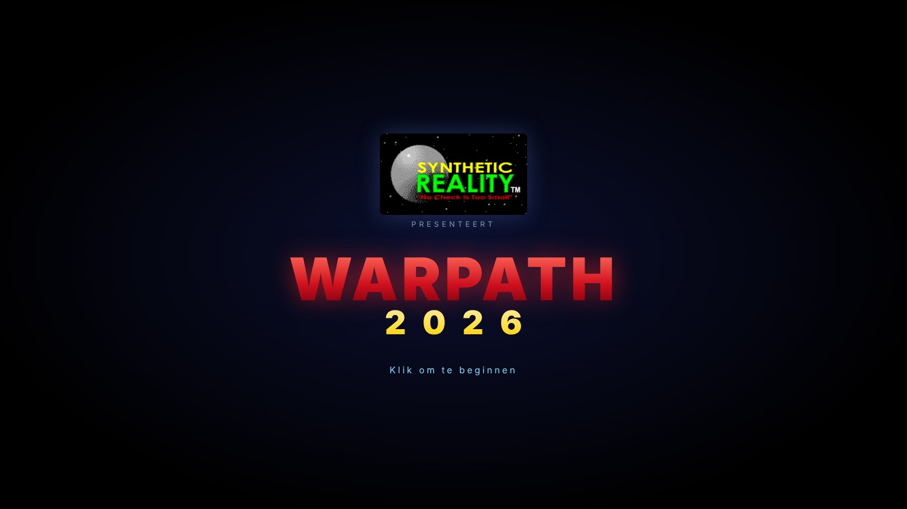
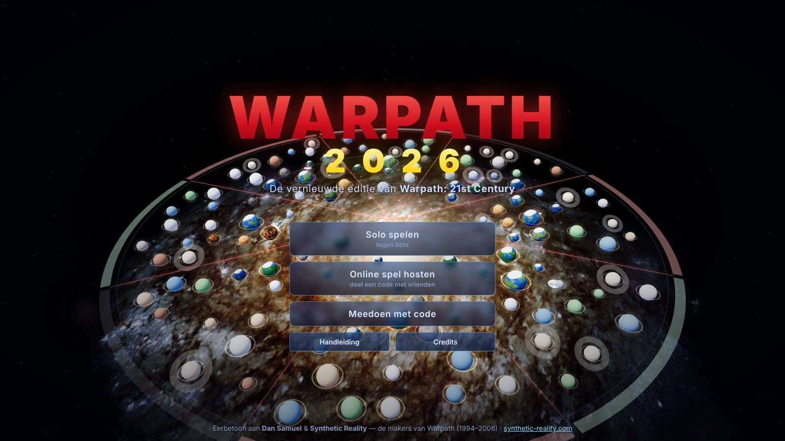
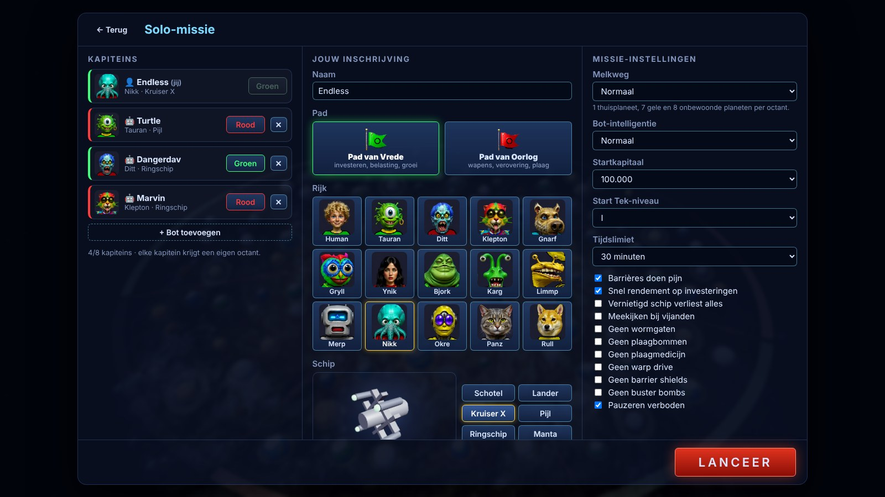
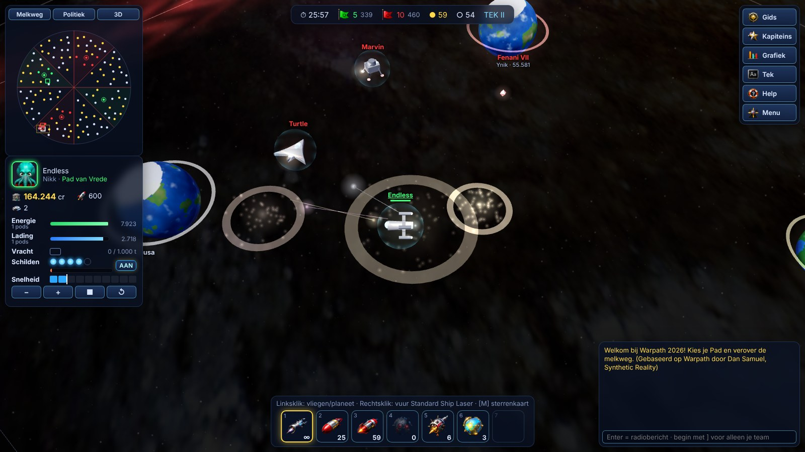
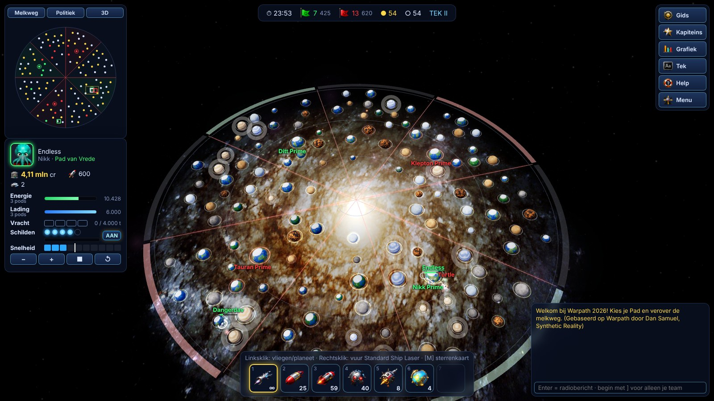
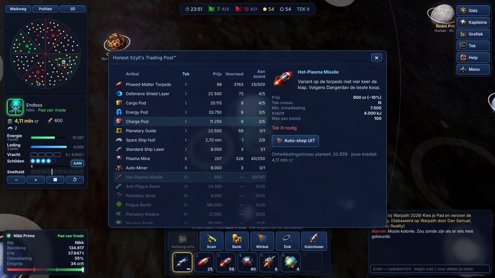
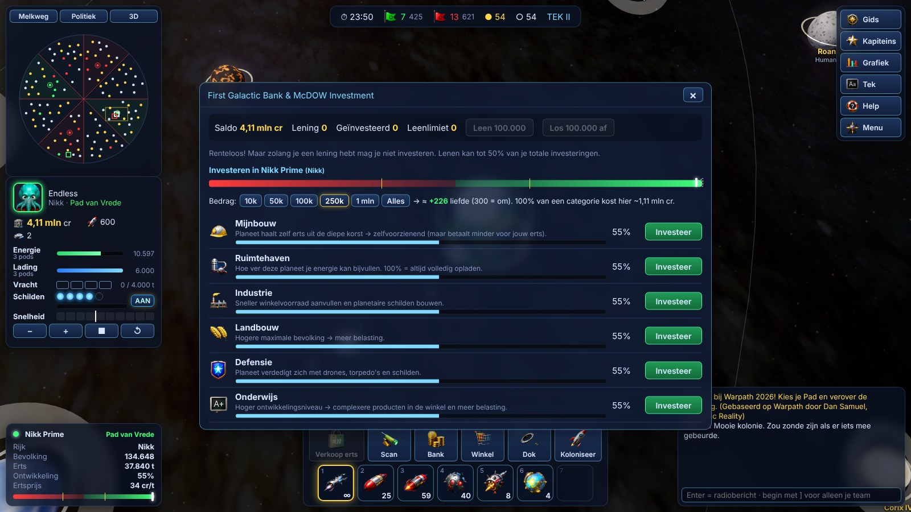
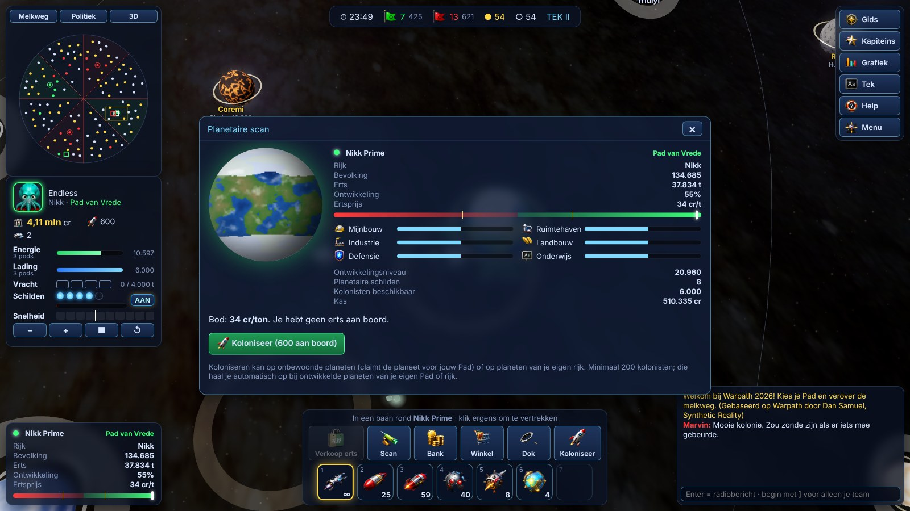
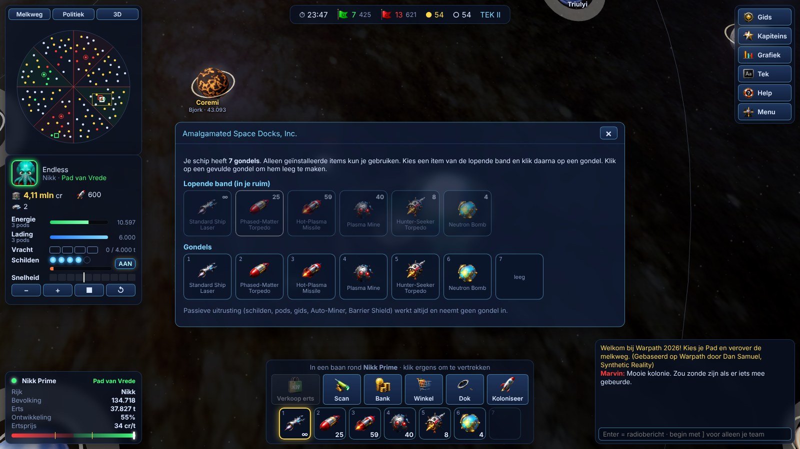

# Warpath 2026

Een vernieuwde 3D-editie van **Warpath: 21st Century** — de real-time, multiplayer ruimte-veroveringsgame van **Dan Samuel / Synthetic Reality**.

▶ **Spelen:** https://endless1977.github.io/Warpath2026/

## Screenshots

| | |
|---|---|
|  |  |
| **Titelkaart** — met het originele opstartgeluid | **Hoofdmenu** — live demo-potje op de achtergrond |
|  |  |
| **Inschrijving** — Pad, rijk, schip en missie-instellingen | **Gevecht** — plasma-raketten, neutronbom en laser |
|  |  |
| **3D-sterrenkaart** (toets M) — 8 octanten en energiebarrières | **Winkel** — Honest Xzyll's Trading Post™ |
|  |  |
| **Bank** — investeren in planeten en lenen | **Planetaire scan** — draaiende planeet, ontwikkeling en bod op je erts |
|  | |
| **Ruimtedok** — kies je 7 gondels | |

## Wat is Warpath?
De melkweg is verdeeld in 8 octanten, gescheiden door energiebarrières. Iedere kapitein kiest het **Pad van Vrede** (groen) of het **Pad van Oorlog** (rood) en probeert zoveel mogelijk planeten voor zijn Pad te winnen: erts mijnen en verkopen, investeren in planeten, koloniseren, belasting innen — of de planeten van de tegenstander ontvolken met torpedo's, neutronbommen en de plaag.

Alle spelregels komen uit de originele helpfile en het tekreport van Warpath 21st Century: 25 items over 10 Tek-niveaus (met de originele prijzen), 6 investeringscategorieën, de First Galactic Bank, noodsignalen, drones, wormgaten, warp, stealth, sonic scream, android slave ships, buster bombs en de missie-instellingen (Normaal/Leeg/Dicht/Power-kaart, bot-niveau van *Kanonnenvoer* tot *Krankzinnig*, tijdslimiet, enz.).

## Nieuw in 2026
- Volledige 3D-weergave (three.js) met procedurele planeten, 6 moderne scheepsontwerpen **plus de 18 originele Warpath-schepen** (de oude bitmaps omgezet naar 3D-blokjes, mét hun knipperende animatie), schildbollen, explosies en een **draaibare 3D-sterrenkaart** (toets **M**).
- **Makkelijk verbinden:** geen modems, IPX of telnet meer. De host krijgt een **spelcode** en een **uitnodigingslink**; vrienden klikken op de link en zitten in de lobby. (WebRTC via PeerJS, de host draait de simulatie.)
- Tot 8 kapiteins, aangevuld met bots. Valt een speler weg, dan neemt een bot het over.
- Duidelijke HUD: meters, live scan, winkel met uitleg waarom iets (nog) niet te koop is, ruimtedok, gids, kapiteinslijst, bevolkingsgrafiek, Tek-rapport en een Nederlandse handleiding (F1).
- De originele geluidseffecten, alien-portretten en iconen (opgeschaald).

## Besturing (kort)
Linksklik = vliegen / in een baan rond een planeet · Rechtsklik of Spatie = vuren · 1–7 = wapen · W/S = sneller/langzamer · X = stop · R = keren · H = schilden · M = sterrenkaart · G = gids · Tab = kapiteins · Enter = radio · F1 = help.

## Lokaal spelen
Open `index.html` in Chrome/Edge. (Online spelen en lettertypes vereisen internet.)
Eigen PeerJS-server (bijv. op een Raspberry Pi)? Voeg `?peer=host:poort` toe aan de URL.

## Credits
- **Warpath**, **Warpath 97** en **Warpath: 21st Century** © Synthetic Reality — **Dan Samuel**, met co-auteur **Benjamin Samuel**. https://www.synthetic-reality.com/history.htm
- De originele geluiden, portretten en iconen in `assets/` en `js/sounds.js` zijn © Synthetic Reality en worden hier met respect hergebruikt als eerbetoon, voor persoonlijk gebruik.
- Achtergrond-melkweg: NGC 4414, dezelfde Hubble-foto als in het originele Warpath: 21st Century (NASA & The Hubble Heritage Team, STScI/AURA), omgerekend naar recht-van-boven-aanzicht.
- Remake: Joris "Endless" Zuijdervliet, 2026.
- three.js (MIT) en PeerJS (MIT), zie `vendor/`.

### Graphics
De kapitein-portretten en iconen zijn in 2026 opnieuw getekend (op basis van de originele Warpath-graphics). De originele opgeschaalde versies staan nog in `assets/portraits_orig/` en `assets/icons_orig/`.
